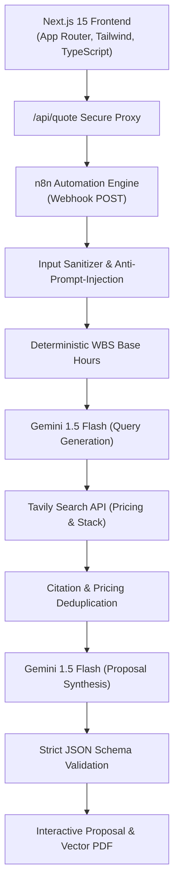

# ScopeCraft AI — Smart Quotation & Estimation Platform

An enterprise-grade AI-powered quotation platform for digital agencies, software consultancies, and product founders. ScopeCraft transforms natural-language project requirements into research-grounded, auditable technical proposals with modular Work Breakdown Structure (WBS) calculations, vendor API pricing benchmarks, and vector-clean PDF exports.

---

## 1. Key Capabilities

- **Adaptive Scoping Wizard:** Progressively discloses vertical-specific questions across 10 major software categories (AI Voice Agents, B2B SaaS, Vector RAG Systems, Corporate Websites, E-Commerce, CRMs, etc.).
- **Live Tavily Web Research:** Dynamically queries official 2025/2026 pricing tables and documentation (Twilio, Deepgram, OpenAI, Stripe, AWS) to ground operational expenses (Opex) in reality.
- **Deterministic WBS Cost Engine:** Decouples arithmetic from LLM generation. Computes baseline engineering hours, complexity multipliers ($0.85\times$ to $1.45\times$), and contingency buffers before proposal synthesis.
- **Dual-Currency Localization:** Supports automatic conversion between **USD ($)** and **Pakistani Rupee (PKR)** with purchasing power parity (PPP) indicators.
- **Vector-Print PDF Engine:** Built-in `@media print` typography system with `break-inside: avoid` rules for crisp, pixel-perfect executive PDF proposals.
- **Production n8n Workflow:** Ready-to-import 11-node workflow with input sanitization, dual Gemini processing, and JSON schema validation.

---

## 2. Architecture & Tech Stack



- **Frontend:** Next.js 15 (App Router), React 19, TypeScript, Tailwind CSS, Lucide Icons.
- **Automation Engine:** n8n (Webhook-driven modular pipeline).
- **Research API:** Tavily Search API.
- **Reasoning Model:** Google Gemini 1.5 Flash / Pro (`application/json` schema mode).

---

## 3. Getting Started

### Prerequisites
- Node.js 18.x or 20.x+
- n8n instance (self-hosted Docker, npm, or n8n Cloud)

### 1. Installation
Clone or navigate to the project directory and install dependencies:

```bash
npm install
```

### 2. Environment Variables
Create a `.env.local` file in the root directory (refer to `.env.example`):

```bash
# n8n Webhook Endpoint
NEXT_PUBLIC_N8N_WEBHOOK_URL=http://localhost:5678/webhook/generate-quotation

# Optional Server-Side API Keys (passed securely to n8n)
GEMINI_API_KEY=your-gemini-api-key
TAVILY_API_KEY=your-tavily-api-key

# Agency Default Rates
DEFAULT_HOURLY_RATE_USD=50
USD_TO_PKR_RATE=278.50
```

### 3. Run Development Server
```bash
npm run dev
```

Open [http://localhost:3000](http://localhost:3000) in your browser.

---

## 4. n8n Workflow Import & Activation

1. Open your n8n dashboard (`http://localhost:5678`).
2. Go to **Workflows** &rarr; **Add Workflow** &rarr; **Import from File**.
3. Select `n8n/quotation_workflow.json`.
4. Add your `GEMINI_API_KEY` and `TAVILY_API_KEY` to your n8n environment or credentials.
5. Save the workflow and toggle it to **Active**.
6. Detailed documentation is available in [`n8n/README.md`](file:///c:/Users/rizi9/Favorites/Downloads/Custom%20Quotation/n8n/README.md).

---

## 5. Automated Testing Suite

We provide an automated integration test script that tests multiple software categories against the scoping engine:

```bash
npm run build
node scripts/test_integration.mjs
```

---

## 6. Directory Structure

```
├── app/
│   ├── api/quote/route.ts       # Secure server-side proxy route
│   ├── globals.css              # Styling & @media print vector PDF rules
│   ├── layout.tsx               # Root layout
│   ├── page.tsx                 # Landing page
│   └── quote/page.tsx           # Quotation wizard & proposal page
├── components/
│   ├── Navbar.tsx               # Header navigation
│   ├── Footer.tsx               # Footer & copyright
│   ├── landing/                 # Hero, HowItWorks, Features, FAQ, Preview
│   ├── wizard/                  # Multi-step wizard controls & dynamic fields
│   └── proposal/ProposalView.tsx# Executive technical proposal UI
├── lib/
│   ├── categories.ts            # Dynamic fields specification for 10 verticals
│   ├── types.ts                 # Full TypeScript contracts
│   └── utils.ts                 # Currency and styling utilities
├── n8n/
│   ├── quotation_workflow.json  # Complete 11-node n8n workflow JSON
│   └── README.md                # n8n setup, webhook testing & payloads
└── scripts/
    └── test_integration.mjs     # End-to-end integration test suite
```

---

## 7. License

Proprietary agency software &mdash; designed for production deployment.
